<picture>
  <source media="(prefers-color-scheme: dark)" srcset="./assets/hero.svg" />
  <source media="(prefers-color-scheme: light)" srcset="./assets/hero-light.svg" />
  
</picture>

  <a href="#selected-projects">Projects</a>
  ·
  <a href="#superkernel">SuperKernel</a>
  ·
  <a href="#systems-toolbox">Toolbox</a>
  ·
  <a href="#get-in-touch">Contact</a>

---

## Systems that stay understandable.

I build the layer underneath PHP services: SuperKernel, a component framework for long-running Swoole
applications; the tooling that packages PHP projects into single binaries; and the automation that keeps running
systems legible. Most of it is open source, and all of it is written to be read as easily as it runs.

<!-- Equal pixel width hints keep GitHub's content-sized table expanded within its available width. -->
<table>
  <tr>
    <td width="1000" valign="top">
      
 &nbsp; <samp>RUNTIME</samp>

      <h3>PHP + Swoole</h3>
      
High-performance PHP runtimes and services.

    </td>
    <td width="1000" valign="top">
      
 &nbsp; <samp>SYSTEMS</samp>

      <h3>Go · Rust · C/C++</h3>
      
Distributed systems, network software, and tooling.

    </td>
    <td width="1000" valign="top">
      
 &nbsp; <samp>TOOLING</samp>

      <h3>Linux · Automation</h3>
      
Containers, reproducible workflows, and tools.

    </td>
  </tr>
</table>

---

## Selected projects

  <a href="https://github.com/wheakerd?tab=repositories&amp;type=source">View all projects →</a>

<table>
  <tr>
    <td width="50%" valign="top">
      <h3><a href="https://github.com/wheakerd/axiom">axiom</a></h3>
      
<em>Workflow guardrails for Codex and Claude Code.</em>

      
Focused skills that turn a request into clear, reviewable work: intent clarification, task planning, research, decision review, and explicit authorization and rollback for consequential actions.

      
<code>Developer tooling</code> <code>AI workflows</code>

    </td>
    <td width="50%" valign="top">
      <h3><a href="https://github.com/wheakerd/mimic">mimic</a></h3>
      
<em>Transparent AOP for PHP.</em>

      
Intercepts class loading and transforms PHP syntax trees to add behavior without manual proxies or edits to original source files.

      
<code>PHP</code> <code>AOP</code> <code>AST</code>

    </td>
  </tr>
</table>

Also in progress: [decomposer](https://github.com/wheakerd/decomposer), a deterministic dependency manager for PHP,
and [prebuilt PHP micro binaries](https://wheakerd.github.io) with an API that picks the right build for a PHP
version and extension set.

---

## SuperKernel

[SuperKernel](https://github.com/super-kernel) is a component-oriented PHP framework for long-running Swoole
applications. Every component is its own Composer package under `super-kernel/*`, built on native PHP attributes,
a PSR-11 container, and the standard PSR interfaces, so an application pulls in exactly the pieces it runs:
attributes are scanned before the application starts, dependencies are autowired, aspects are woven through source
transformation, and PSR-3, PSR-7, PSR-14, and PSR-15 keep the rest interoperable.

It is under active development and not yet released; each repository's `main` branch is the current line.

  
Component map

  <table>
    <tr>
      <td><strong>Runtime</strong></td>
      <td><a href="https://github.com/super-kernel/swoole"><code>swoole</code></a> <a href="https://github.com/super-kernel/server"><code>server</code></a> <a href="https://github.com/super-kernel/http-server"><code>http-server</code></a> <a href="https://github.com/super-kernel/http-message"><code>http-message</code></a> <a href="https://github.com/super-kernel/process"><code>process</code></a> <a href="https://github.com/super-kernel/pool"><code>pool</code></a></td>
    </tr>
    <tr>
      <td><strong>Container</strong></td>
      <td><a href="https://github.com/super-kernel/di"><code>di</code></a> <a href="https://github.com/super-kernel/config"><code>config</code></a> <a href="https://github.com/super-kernel/environment"><code>environment</code></a> <a href="https://github.com/super-kernel/context"><code>context</code></a> <a href="https://github.com/super-kernel/contract"><code>contract</code></a></td>
    </tr>
    <tr>
      <td><strong>Metaprogramming</strong></td>
      <td><a href="https://github.com/super-kernel/attribute"><code>attribute</code></a> <a href="https://github.com/super-kernel/annotator"><code>annotator</code></a> <a href="https://github.com/super-kernel/reflector"><code>reflector</code></a> <a href="https://github.com/super-kernel/tokenizer"><code>tokenizer</code></a> <a href="https://github.com/super-kernel/scan-isolation"><code>scan-isolation</code></a> <a href="https://github.com/super-kernel/aop"><code>aop</code></a> <a href="https://github.com/super-kernel/mimic"><code>mimic</code></a></td>
    </tr>
    <tr>
      <td><strong>Application</strong></td>
      <td><a href="https://github.com/super-kernel/framework"><code>framework</code></a> <a href="https://github.com/super-kernel/command"><code>command</code></a> <a href="https://github.com/super-kernel/autoloader"><code>autoloader</code></a> <a href="https://github.com/super-kernel/composer"><code>composer</code></a> <a href="https://github.com/super-kernel/composer-source-reference-plugin"><code>composer-source-reference-plugin</code></a> <a href="https://github.com/super-kernel/support"><code>support</code></a></td>
    </tr>
    <tr>
      <td><strong>Operations</strong></td>
      <td><a href="https://github.com/super-kernel/logger"><code>logger</code></a> <a href="https://github.com/super-kernel/event"><code>event</code></a> <a href="https://github.com/super-kernel/event-dispatcher"><code>event-dispatcher</code></a> <a href="https://github.com/super-kernel/exception-dispatcher"><code>exception-dispatcher</code></a> <a href="https://github.com/super-kernel/filesystem"><code>filesystem</code></a> <a href="https://github.com/super-kernel/redis"><code>redis</code></a></td>
    </tr>
  </table>

---

## Systems toolbox

<picture>
  <source media="(prefers-color-scheme: dark)" srcset="./assets/stack.svg" />
  <source media="(prefers-color-scheme: light)" srcset="./assets/stack-light.svg" />
  
</picture>

## GitHub activity

Public repository statistics across my profile and the SuperKernel organization, refreshed daily.

<picture>
  <source media="(prefers-color-scheme: dark)" srcset="https://raw.githubusercontent.com/wheakerd/wheakerd/output/readme-tools_github-readme-stats-dark.svg?v=5" />
  <source media="(prefers-color-scheme: light)" srcset="https://raw.githubusercontent.com/wheakerd/wheakerd/output/readme-tools_github-readme-stats.svg?v=5" />
  
</picture>

 

<picture>
  <source media="(prefers-color-scheme: dark)" srcset="https://raw.githubusercontent.com/wheakerd/wheakerd/output/platane_grid_snake-dark.svg?v=2" />
  <source media="(prefers-color-scheme: light)" srcset="https://raw.githubusercontent.com/wheakerd/wheakerd/output/platane_grid_snake.svg?v=2" />
  
</picture>

---

## Get in touch

For project questions and bug reports, open an issue in the relevant repository. For collaboration around PHP
infrastructure, runtime performance, Linux tooling, or developer automation, reach me by email.

  <a href="mailto:wheakerd@gmail.com"><strong>wheakerd@gmail.com</strong></a>

  <samp>Build deep. Ship clean. Keep the system legible.</samp>

